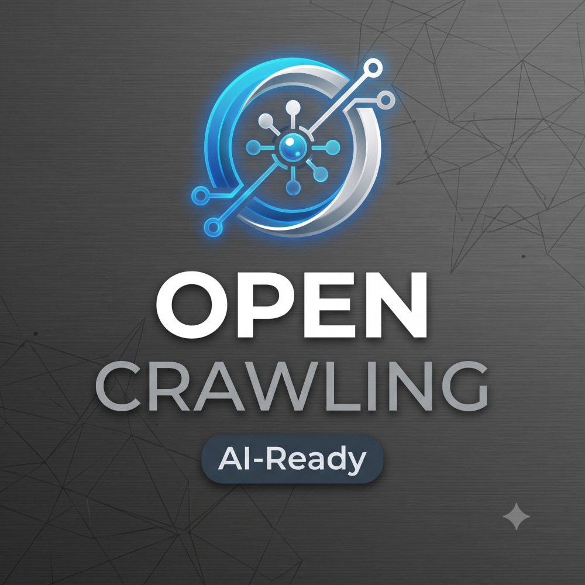

# Welcome to OpenCrawling 🌐

  

  
  
  
  
  
  
  
  

  
  
  
  
  
  
  
  
  
  
  
  
  
  
  
  
  
  
  
  

**High-Performance Enterprise Data Ingestion, Federation & Security Framework for AI and Search.**

**OpenCrawling** is the reference Java and Spring Framework implementation of the **[Open Ingestion Standard (OIS)](https://github.com/opencrawling/open-ingestion-standard)**. It is an open-source, cloud-native platform designed to solve the hardest problem in enterprise AI and search: **securely connecting siloed content repositories to modern RAG, vector search, and data lakehouse pipelines.**

Going far beyond simple web scraping, OpenCrawling acts as an intelligent, security-aware bridge between enterprise content stores (ECM, DMS, BPM/workflow engines, relational databases, data lakehouses, web crawlers) and modern search engines, vector databases, and Large Language Model (LLM) agents.

---

## 💡 Why OpenCrawling?

When building Retrieval-Augmented Generation (RAG) systems or enterprise search, getting the data is only half the battle. You also need to respect document permissions, propagate deletions (`DELETE` tombstones), handle incremental updates, and scale without bottlenecking source systems.

OpenCrawling is built from the ground up to address these challenges with modern software architecture:

*   🔒 **Enterprise Security First (Zero-Trust ACL Mapping):** Built-in synchronization of native Access Control Lists (ACLs) with deny-by-default enforcement. We ensure that your vector databases, search engines, and MCP-enabled AI agents only return documents the querying user is explicitly authorized to see.
*   ⚡ **High-Performance & Non-Blocking:** Powered by **Java 25** and **Spring Boot 4.1+**, leveraging Virtual Threads and Structured Concurrency alongside decoupled **Apache Kafka** and **gRPC** streaming pipelines for massive I/O throughput.
*   🤖 **AI, RAG & MCP Ready:** Native support for Apache Tika text extraction, semantic chunking, stateless multi-provider embedding generation (**Spring AI 2.0+** / Ollama / OpenAI), and a built-in **Model Context Protocol (MCP)** server with pre-filtered ACL security.
*   📊 **AI-Powered Observability (AIOps) & Lakehouse Audit Ledger:** Native OpenTelemetry (OTel) correlated traces, Micrometer metrics, automated root-cause analysis (RCA) in the Admin UI, and an immutable Apache Iceberg / Ozone ingestion audit ledger.
*   🔌 **Pluggable SPI & Maven Archetypes:** Clean, modular Java SPIs (`RepositoryConnector`, `TransformationConnector`, `OutputConnector`) and official Maven Archetypes (`opencrawling-connector-archetypes`) to scaffold custom connectors in seconds.

---

## 📦 Organization Repositories

| Repository | Description |
| :--- | :--- |
| **[`opencrawling`](https://github.com/opencrawling/opencrawling)** | The core OpenCrawling platform, runtime engine, decoupled embedding microservice, React Admin UI, CLI, and enterprise connector suite. |
| **[`open-ingestion-standard`](https://github.com/opencrawling/open-ingestion-standard)** | The **Open Ingestion Standard (OIS)** vendor-neutral specification and JSON schemas for secure document ingestion, ACL tokens, and tombstone lifecycles. |
| **[`homebrew-tap`](https://github.com/opencrawling/homebrew-tap)** | Official Homebrew tap for installing the OpenCrawling CLI (`oc`) on macOS and Linux. |
| **[`opencrawling.github.io`](https://github.com/opencrawling/opencrawling.github.io)** | Official documentation and project website ([opencrawling.org](https://opencrawling.org)). |

---

## 🏗️ Core Architecture & Platform Modules

Inside [`opencrawling/opencrawling`](https://github.com/opencrawling/opencrawling), the platform is organized into decoupled modules:

| Module | Description |
| :--- | :--- |
| **`oc-core`** | Core SPIs (`RepositoryConnector`, `TransformationConnector`, `OutputConnector`), OIS domain models, security ACL contracts, and Virtual Thread orchestration. |
| **`oc-runtime`** | Spring Boot 4 ingestion runtime engine, Kafka streaming consumers/producers, Tika extraction, semantic chunking, REST API, and secure **MCP Server**. |
| **`oc-embedding-service`** | Stateless, horizontally scalable embedding microservice supporting dynamic multi-dimension models (`384` / `768` / `1024`) via Spring AI. |
| **`oc-admin-ui`** | React / TypeScript administration console for managing connectors, jobs, security mappings, Apache ManifoldCF migrations, and AIOps diagnostics. |
| **`oc-cli` & `oc-java-client-sdk`** | Command-line interface (`oc`) and Java Client SDK for declarative pipeline automation and CI/CD integration. |
| **`oc-grpc-api` & `oc-grpc-push-connector`** | High-performance Protobuf / gRPC internal transport and external push ingestion gateway. |
| **`oc-observability`** | OpenTelemetry trace correlation, Micrometer metrics, and AI-driven root-cause analysis (RCA). |
| **`oc-mcf-migrator`** | Automated migration engine to convert legacy Apache ManifoldCF job/connection definitions into OpenCrawling pipelines. |
| **`oc-connector-archetypes`** | Published Maven Central archetypes for scaffolding custom Repository, Transformation, and Output connectors. |

---

## 🔌 Supported Enterprise Connectors

### Source / Repository Connectors
*   **Enterprise Content Management (ECM / DMS / CSP):**
    *   **Alfresco Content Services (ACS)** (`oc-alfresco-repository-connector`)
    *   **OASIS CMIS 1.0 / 1.1** (`oc-cmis-repository-connector` — native Java 25 Browser Binding client)
    *   **Doxis 4** (`oc-doxis-repository-connector` — SER Group Doxis CSB REST API with e-file & ACL mapping)
    *   **M-Files** (`oc-mfiles-repository-connector` — M-Files Web Service MFWS REST API & VAF incremental change feed)
    *   **SharePoint Online** (`oc-sharepoint-repository-connector` — Microsoft Graph v1.0 delta & tree crawling with Entra ID OAuth2)
    *   **Hyland OpenArch** (`oc-openarch-repository-connector` — Content Innovation Cloud / OpenArch repository source)
*   **Business Process Management (BPM / Workflow):**
    *   **Alfresco Process Services (APS 26.2)** (`oc-aps-repository-connector` — REST + APS MCP Server discovery)
    *   **Flowable BPMN** (`oc-flowable-repository-connector`)
    *   **Camunda BPM** (`oc-camunda-repository-connector`)
*   **Data Lakehouse, Databases, Web & Streaming:**
    *   **Apache Iceberg** (`oc-iceberg-repository-connector`)
    *   **Apache StormCrawler** (`oc-stormcrawler-repository-connector` & `oc-stormcrawler-bolt`)
    *   **JDBC Relational Databases** (`oc-jdbc-repository-connector`)
    *   **Local & Network Filesystems** (`oc-filesystem-repository-connector`)
    *   **gRPC Push Ingestion Gateway** (`oc-grpc-push-connector`)

### Target / Output Connectors (Vector, Search & Lakehouse)
*   **Vector & Hybrid Search Engines:** PostgreSQL (`pgvector`), **Apache Solr 10**, **OpenSearch 2.x / 3.x**, **Vespa 8**, **Milvus**, **Qdrant**, **Luxir**
*   **Object Storage, Archive & Multi-Sink Federation:** **Apache Ozone** (with Claim Check pattern), **Hyland OpenArch**, **Apache SeaTunnel** (Zeta Engine fan-out to 100+ sinks)

---

## 🛠️ Technology Stack

*   **Core:** Java 25 (Virtual Threads & Structured Concurrency), Spring Boot 4.1+, Spring AI 2.0+
*   **Streaming & RPC:** Apache Kafka, gRPC / Protobuf, Model Context Protocol (MCP)
*   **Extraction & Lakehouse:** Apache Tika 4.1, Apache Iceberg 1.11, Apache Ozone 2.2
*   **Build & Deployment:** Maven Multi-Module, Docker Compose, Kubernetes, Homebrew
*   **License:** Apache License 2.0

---

## 🤝 Get Involved

We are building a community of developers, architects, and data engineers passionate about open-source enterprise data integration and AI infrastructure.

*   🌐 **Official Website:** [opencrawling.org](https://opencrawling.org)
*   📖 **Read the Documentation:** [GitHub Wiki](https://github.com/opencrawling/opencrawling/wiki) & [DeepWiki AI Docs](https://deepwiki.com/opencrawling/opencrawling)
*   📐 **Standard Specification:** [Open Ingestion Standard (OIS)](https://github.com/opencrawling/open-ingestion-standard)
*   🐛 **Report Issues:** [Issue Tracker](https://github.com/opencrawling/opencrawling/issues)
*   💬 **Join the Discussion:** [Slack Community](https://join.slack.com/t/opencrawling/shared_invite/zt-43r2anb6q-YLoBsOrxCCcBWU5Up3P1rw)
*   ✉️ **Official Contact:** Reach out to us at [info@opencrawling.org](mailto:info@opencrawling.org) for general inquiries or security reports.
*   ⭐ **Star our Repositories:** If you find our work useful, give us a star!

*Built with passion for the Open Source and AI community.*
